 

**Freelance full-stack developer. Next.js, React and Laravel sites built from your brief or design file, fast and pixel-perfect.**

  

 

## Your idea, your stack, one codebase

Whatever you bring, a written brief, a design file, a WordPress site that has outgrown itself or a spreadsheet of products, it comes out the other side as one production codebase in the tools your team already runs.

 

## How I work

| | |
|---|---|
| **Build one component, get every screen** | Phone, tablet, desktop and print come from the same components. No separate mobile site, no drift. |
| **Your idea stays your idea** | The layout, the type and the details you cared about survive the build. Compare the brief with the page it became on the site. |
| **Typed, tested, documented** | TypeScript end to end, CI on every push, a hand-off your next developer can read. |
| **Fast delivery** | AI-assisted workflows cut typical delivery from about a month to about ten days, without cutting review. |

 

## Stack

 

## Selected work

| Project | Sector | Stack |
|---|---|---|
| Freight quote platform | Logistics | Vue 3 · Laravel · MySQL |
| Healthcare billing services platform | Healthcare | Vue 3 · Laravel · MySQL |
| Seasonal produce online store | E-commerce | Vue 3 · Laravel · MySQL |
| Quote site for a metal fabricator | Trade services | Vue 3 · Laravel |
| GP clinic website | Healthcare | WordPress |
| Accounting firm marketing site | Professional services | WordPress |

Twenty-plus businesses run on sites I built. Client names are withheld under NDA. Full case studies are coming to the site.

 

## Open source

- **[create-atomictemplate](https://www.npmjs.com/package/create-atomictemplate)** · Next.js + React project starter, on npm
- **[vue-laravel-boilerplate](https://github.com/nomanjawad/vue-laravel-boilerplate)** · Vue 3 + Laravel API architecture for client builds
- **[wordpress-node](https://github.com/nomanjawad/wordpress-node)** · React + headless WordPress over GraphQL

## Publication

**IoT-Based Solar Automated Irrigation System** · IEEE Xplore · [DOI 10.1109/10653615](https://doi.org/10.1109/10653615)

 

## Currently

Leading a small team at SkyTech Solutions: architecture, code review, mentoring and end-to-end delivery. Based in Dhaka, UTC+6, working with clients worldwide.

 

**Planning something?** The quickest way to start is a two-line brief.

This repository is also the source of <a href="https://www.nomanjawad.com">nomanjawad.com</a>: Next.js 16, React 19, GSAP and Lenis, deployed on Vercel.

